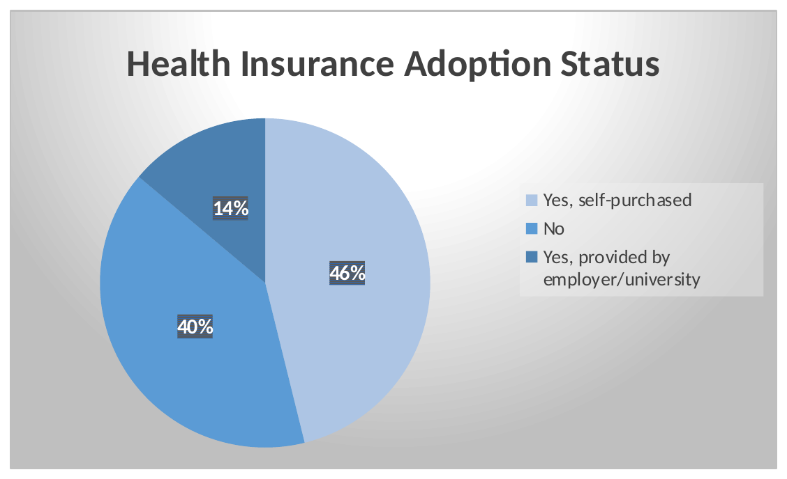
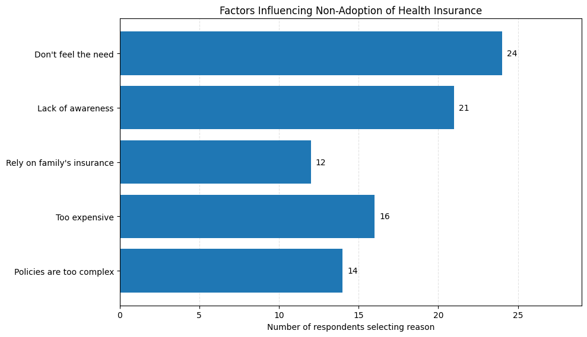
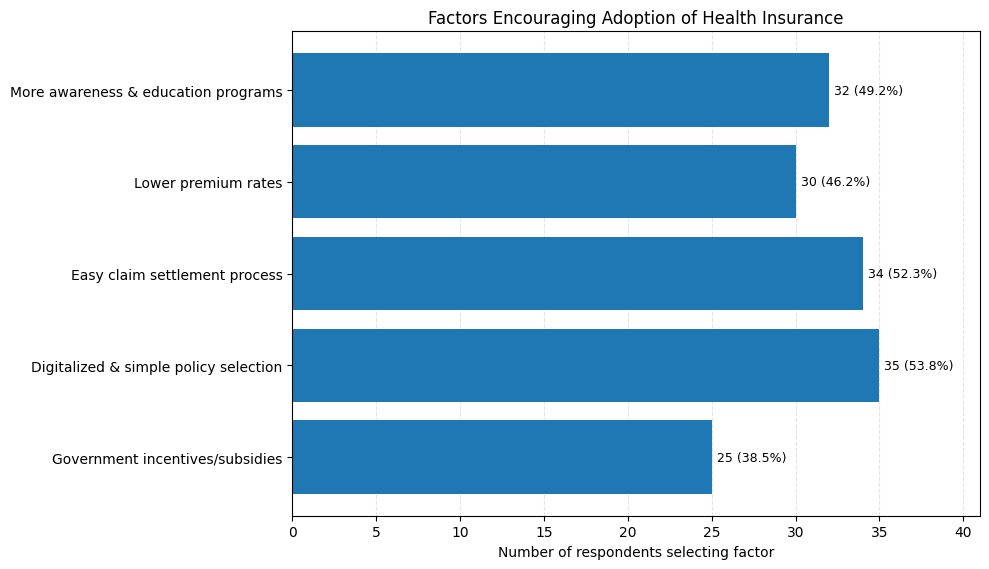

# A Study On Customer Awareness and Adoption On Health Insurance Among Educated Youth

A survey-based study of how aware educated young adults in India are of health insurance, whether they actually hold a policy, and what stops or encourages them. The project covers the full workflow: questionnaire data, descriptive analysis, hypothesis tests (chi-square, Spearman correlation), a logistic regression model, charts and a written research paper.

<p align="center">
  
</p>

## Contents

- [Key findings](#key-findings)
- [Research objectives](#research-objectives)
- [Dataset](#dataset)
- [Methodology](#methodology)
- [Results](#results)
- [Repository structure](#repository-structure)
- [Reproducing the results](#reproducing-the-results)
- [Limitations](#limitations)
- [Author](#author)

## Key findings

- **Awareness is high, ownership is lower.** 92.3% of respondents know about health insurance at least somewhat (47.7% fully aware), but only 60% hold a policy.
- **Awareness alone does not explain ownership.** The chi-square test between awareness level and ownership is not significant (p = 0.200).
- **Income and employment do.** Respondents earning ₹20,000 or more are insured at 82.6% against 47.6% for the rest. Employed or self-employed respondents are insured at 78.1% against 42.4% for students. Both differences are statistically significant.
- **Awareness does relate to future intent.** Higher awareness goes with a higher intention to buy insurance later (Spearman rs = 0.302, p = 0.015).
- **Main barriers:** high premiums (41.5%), a difficult claim process (41.5%) and limited understanding (33.8%).
- **What would help:** simple digital policy selection (53.8%), easy claim settlement (52.3%) and awareness programmes (49.2%).

## Research objectives

1. Measure how aware educated youth are of health insurance and where they learn about it.
2. Describe how many hold a policy and which plan types they use.
3. Test whether awareness, income and employment are linked to owning insurance.
4. Identify the barriers to buying and the factors that would encourage it.

## Dataset

| Item | Detail |
|---|---|
| File | `data/raw/health_insurance_survey_responses.csv` |
| Respondents | 65 educated young adults |
| Variables | 18 questionnaire items (demographics, awareness, ownership, barriers, motivators, satisfaction) |
| Collection | Structured questionnaire, convenience sampling |
| Profile | 78.5% male, 72.3% postgraduate, 58.5% aged 18-22 |

Column definitions, answer options and known data issues are in [`data/data_dictionary.md`](data/data_dictionary.md) (also available as a Word file).

## Methodology

| Step | Technique |
|---|---|
| Descriptive analysis | Frequency tables, percentages, cross-tabulations |
| Association tests | Chi-square test of independence (awareness, income group and employment group vs ownership) |
| Correlation | Spearman rank correlation (awareness vs purchase intention; income vs ownership) |
| Modelling | Logistic regression for insurance ownership, estimated by maximum likelihood (Excel Solver) and checked independently in Python |
| Tools | Microsoft Excel, Python (pandas, NumPy, SciPy) |

## Results

### Who responded

<p>
  
  
</p>

### Awareness

Most respondents are at least somewhat aware of health insurance, and social media and family are the main sources of information.

<p>
  
  
</p>

### Adoption: barriers and motivators

<p>
  
  
</p>

### Hypothesis tests

| Hypothesis | Test | Statistic | p-value | Decision (5%) |
|---|---|---|---|---|
| Awareness vs current ownership | Chi-square | χ²(2) = 3.215 | 0.200 | Not significant |
| Income group vs current ownership | Chi-square | χ²(1) = 7.581 | 0.006 | Significant |
| Employment group vs current ownership | Chi-square | χ²(1) = 8.628 | 0.003 | Significant |
| Awareness vs future purchase intention | Spearman | rs = 0.302 | 0.015 | Significant |
| Income category vs current ownership | Spearman | rs = 0.304 | 0.014 | Significant |

Share of each group that holds insurance:

| Group | Insured |
|---|---|
| Income below ₹20,000 (or none) | 47.6% (20 of 42) |
| Income ₹20,000 or above | 82.6% (19 of 23) |
| Students | 42.4% (14 of 33) |
| Employed / self-employed | 78.1% (25 of 32) |

### Logistic regression

Dependent variable: currently insured (1) or not (0). n = 65, McFadden pseudo R² = 0.157, likelihood-ratio test χ²(4) = 13.73, p = 0.008.

| Predictor | Odds ratio | 95% CI | p-value |
|---|---|---|---|
| Awareness (0-2) | 1.75 | 0.69 – 4.41 | 0.236 |
| Income category (0-4) | 1.56 | 0.82 – 2.97 | 0.178 |
| Perceived importance (0-2) | 2.94 | 0.86 – 10.09 | 0.087 |
| Student (1 = student) | 0.30 | 0.08 – 1.10 | 0.070 |

The model as a whole fits better than a model with no predictors, but no single predictor is significant at the 5% level. Perceived importance and student status come closest. The wide confidence intervals reflect the small sample.

Full tables are in the [`results/`](results) folder.

## Repository structure

```
.
├── README.md
├── data/
│   ├── raw/
│   │   └── health_insurance_survey_responses.csv
│   ├── data_dictionary.md
│   └── data_dictionary.docx
├── analysis/
│   └── Health_Insurance_Study_Analysis_with_Charts.xlsx
├── report/
│   └── Research_Paper.docx
├── charts/
│   ├── demographics/
│   ├── awareness/
│   └── adoption/
└── results/
    ├── README.md
    ├── hypothesis_testing_summary.csv
    ├── reproduce_results.py
    ├── 01_descriptive/
    ├── 02_crosstabs/
    ├── 03_chi_square_tests/
    ├── 04_correlation/
    └── 05_logistic_regression/
```

## Reproducing the results

```bash
pip install numpy pandas scipy
cd results
python reproduce_results.py
```

The script re-computes the three chi-square tests and the logistic regression from the tables stored in `results/` and prints the same values reported above.

## Limitations

- **Small, non-random sample.** 65 respondents chosen by convenience sampling, so the results describe this group and should not be generalised to all educated youth in India.
- **Small categories.** Only 5 respondents were "not aware", so the awareness chi-square test has some expected counts below 5 and should be read as indicative.
- **Cross-sectional data.** The tests show association, not cause and effect.
- **Gender and education skew.** The sample is mostly male and postgraduate.
- **Self-reported answers** may be affected by recall or social-desirability bias.

## Author

**Shrestha Sarkar**
PGDM (Finance and Business Analytics), ISBR Business School, Bangalore
